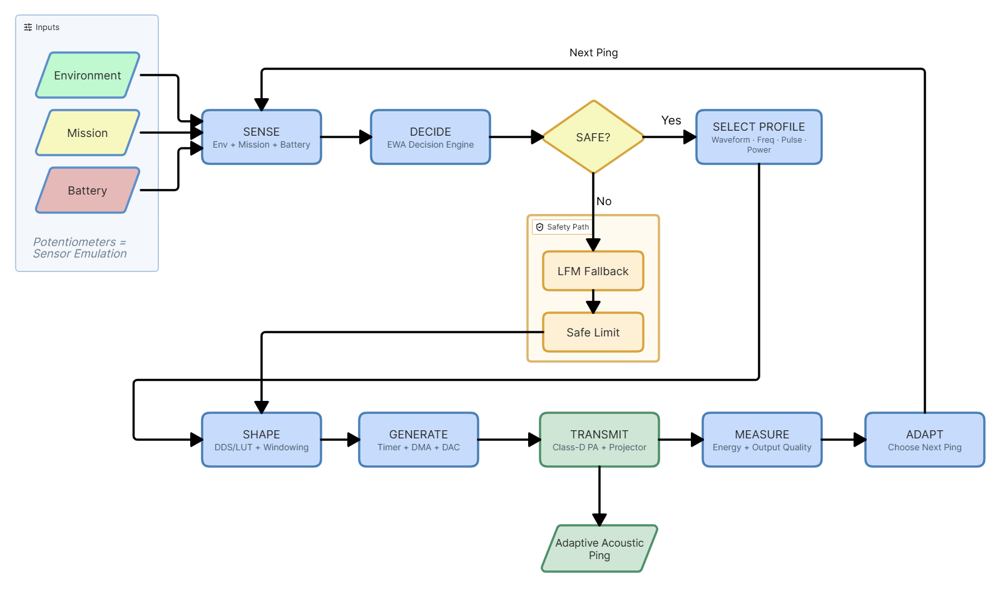
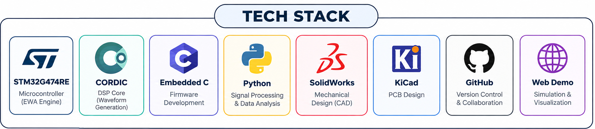
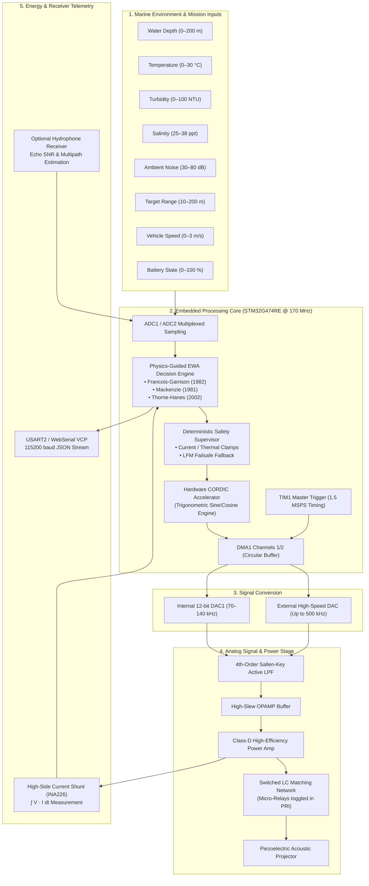

# AERO-SONAR — System Architecture & Engineering Flow

**Smart India Hackathon 2026 — Problem Statement 26058**  
**Ministry of Earth Sciences (MoES) / National Institute of Ocean Technology (NIOT)**  
**Team Name:** AEROS | **Team ID:** 186870  
**Project:** AERO-SONAR : Adaptive Software-Defined Sonar Transmitter Payload for AUVs  
**Tagline:** *Sense • Decide • Shape • Save*  

---

## 1. System Overview

Autonomous Underwater Vehicles (AUVs) face dynamically shifting marine operating environments. Conventional underwater acoustic transmitters are restricted to fixed transmission parameters (single carrier frequency, fixed pulse duration, static transmit amplitude, and fixed pulse repetition intervals). As an AUV traverses thermoclines, shallow river mouths, sediment-dense estuaries, or deep bathymetric trenches, fixed transmission profiles lead to severe link degradation:
- **High-Frequency Extinction:** Operating at high frequencies (>300 kHz) in deep or turbid waters results in massive absorption loss (>120 dB/km), causing total loss of acoustic return before reaching target or seabed.
- **Resolution Sacrifice:** Operating statically at low frequencies (<70 kHz) in clear shallow waters wastes the opportunity for sub-centimeter bathymetric resolution.
- **Energy Wastage:** Over-transmitting acoustic power in clean, short-range channels drains the vehicle's lithium-ion battery reserves, drastically reducing mission endurance.

**AERO-SONAR** solves this through a **real-time, physics-guided, software-defined sonar transmitter payload** executing deterministic ping-by-ping adaptation.

```text
┌─────────────────────────────────────────────────────────────────────────────────────────┐
│                           AERO-SONAR END-TO-END DATAFLOW PIPELINE                       │
├─────────────────────────────────────────────────────────────────────────────────────────┤
│                                                                                         │
│  [1] MULTI-SENSOR INGESTION (4 PS Mandate + 4 Team Acoustic Innovations)               │
│      ├── Depth (m)          ├── Temperature (°C)      ├── Turbidity (NTU)               │
│      ├── Salinity (ppt)     ├── Ambient Noise (dB)    ├── Target Range (m)              │
│      ├── Velocity (m/s)     └── Battery Level (%)                                       │
│                                      │                                                  │
│                                      ▼                                                  │
│  [2] DATA PREPROCESSING & ADAPTIVE DECISION ENGINE (STM32G474RE)                       │
│      ├── Sensor Validation & Noise Filtering (Moving Median + IQR)                      │
│      ├── Ocean Acoustic Modeling:                                                       │
│      │   • Sound Speed: Mackenzie (1981) 9-term polynomial                              │
│      │   • Acoustic Absorption: François-Garrison (1982) multi-relaxation               │
│      │   • Sediment Scattering: Thorne & Hanes (2002) particulate model                 │
│      │   • Active Sonar Equation Link Budget: Urick (1983)                              │
│      ├── Multi-Objective Objective Function: Maximize Resolution, Minimize Energy       │
│      └── Operating Corridor Selection: HIGH-RES | BALANCED | LONG-RANGE | POWER-SAVE   │
│                                      │                                                  │
│                                      ▼                                                  │
│  [3] DETERMINISTIC HARDWARE WAVEFORM SYNTHESIS (Zero CPU Load)                         │
│      ├── Hardware CORDIC Coprocessor (Real-time trigonometric rotation)                 │
│      ├── Timer Triggered (TIM1 / TIM8 HRTIM)                                            │
│      ├── Dual Direct Memory Access (DMA1 / DMA2 ping-pong buffers)                      │
│      └── Waveform Modulation: LFM Chirp | HFM (Doppler Tolerant) | Barker-13 | CW       │
│                                      │                                                  │
│                                      ▼                                                  │
│  [4] DUAL-BAND DIGITAL-TO-ANALOG CONVERSION                                             │
│      ├── Internal 12-bit DAC: 70 kHz – 140 kHz (Efficient Coastal Surveying)           │
│      └── External High-Speed DAC: Up to 500 kHz (1.0 cm Razor-Sharp Inspection)        │
│                                      │                                                  │
│                                      ▼                                                  │
│  [5] ANALOG CONDITIONING & POWER STAGE                                                  │
│      ├── Sallen-Key 4th-Order Butterworth Reconstruction Filter                         │
│      ├── High-Efficiency Class-D Power Amplifier (>88% efficiency)                      │
│      ├── Switched LC Impedance Matching Network (PRI quiet-interval toggling)           │
│      └── Piezoelectric Acoustic Projector (Broadband Tonpilz Transducer)                │
│                                      │                                                  │
│                                      ▼                                                  │
│  [6] CLOSED-LOOP ENERGY & ECHO FEEDBACK                                                 │
│      ├── Real-Time Current Shunt Monitor (∫ V · I dt Energy-per-Ping Calculation)       │
│      └── Optional Hydrophone Receiver (Echo SNR, Multipath & Doppler Re-estimation)     │
│                                                                                         │
└─────────────────────────────────────────────────────────────────────────────────────────┘
```

### Visual Engineering Flowcharts & Architecture Maps

| Complete Architectural Flow | Technical Approach Block Diagram |
| :---: | :---: |
|  |  |

---

## 2. System Block Diagram & Interfaces



---

## 3. Dual-Band Acoustic Scalability (70–140 kHz & 500 kHz)

A key differentiator of AERO-SONAR over primitive transmitters is its **dual-band operational envelope**:

| Parameter | Band 1: Coastal & Long-Range | Band 2: Ultra-High Resolution |
|---|---|---|
| **Carrier Frequency ($f_0$)** | 70 kHz – 140 kHz | 450 kHz – 500 kHz |
| **Transducer Drive Method** | STM32G4 Internal 12-bit DAC | High-Speed External Parallel/SPI DAC |
| **Typical Bandwidth ($B$)** | 10.5 kHz – 21.0 kHz | 75.0 kHz |
| **Range Resolution ($\Delta R = \frac{c}{2B}$)** | 3.6 cm – 7.1 cm | **1.0 cm (Razor-sharp)** |
| **Acoustic Absorption in Seawater** | 21.8 dB/km – 46.2 dB/km | ~143.0 dB/km |
| **Maximum Usable Range** | Up to 180 m | 25 m – 35 m |
| **Primary Operational Role** | Pipeline tracking, long-range obstacle avoidance, deep-water cruising | Centimeter benthic mapping, mine countermeasures (MCM), ship hull inspection |

---

## 4. Hardware CORDIC Coprocessor Waveform Synthesis

Rather than relying on large precomputed lookup tables (which consume precious SRAM and limit frequency resolution) or expensive software runtime `sinf()` calculations (which consume CPU cycles and battery energy), AERO-SONAR utilizes the **hardware CORDIC (COordinate Rotation DIgital Computer) peripheral** native to the STM32G4:

1. **Deterministic Phase Generation:** A 32-bit hardware phase accumulator updates with each timer tick:
   $$\theta[n] = \theta[n-1] + \Delta\theta[n]$$
   where for an LFM chirp, $\Delta\theta[n]$ increments linearly according to the chirp slope $k = \frac{f_{\text{stop}} - f_{\text{start}}}{\tau}$.
2. **CORDIC Trigonometric Acceleration:** The normalized angle $\theta$ is pushed into the `CORDIC->WDATA` register. The CORDIC coprocessor computes the 24-bit fixed-point sine output in **just 4 clock cycles** without software intervention.
3. **Autonomous DMA Streaming:** DMA transfers the computed sample from `CORDIC->RDATA` directly into the DAC holding register (`DAC1->DHR12R1`).
4. **Zero CPU Overhead:** The STM32 Cortex-M4 CPU remains completely asleep or dedicated to running the EWA adaptation calculations during transmission.

---

## 5. Waveform Library & Modulation Properties

```text
1. LFM Chirp (Linear Frequency Modulation)
   • s(t) = A(t) · sin(2π(f_start · t + 0.5 · k · t²))
   • Provides large time-bandwidth product (BT >> 1) and significant pulse compression gain:
     Gp = 10 · log10(B · τ) [dB]
   • Default workhorse waveform for high-SNR ranging and clutter rejection.

2. HFM / Geometric Sweep (Hyperbolic Frequency Modulation)
   • Instantaneous frequency follows a hyperbolic curve: f(t) = f_start / (1 + k_h · t)
   • True scale-invariance and Doppler tolerance: maintains matched-filter peak even when 
     AUV speed induces significant Doppler compression/expansion.
   • Automatically triggered when Doppler index D > 2.0.

3. Barker-13 BPSK (Phase-Coded Pulse)
   • 13-chip optimal binary sequence: [+1, +1, +1, +1, +1, -1, -1, +1, +1, -1, +1, -1, +1]
   • Delivers 11.1 dB peak-to-sidelobe ratio with zero range-Doppler coupling.
   • Ideal for covert or reverberation-limited environments.

4. Continuous Wave (CW) Pulse
   • Constant carrier frequency burst.
   • Narrowband Doppler resolution for precise water current and vehicle ground speed tracking.
```

---

## 6. Switched LC Impedance Matching Network

Underwater piezoelectric transducers behave as highly capacitive, complex reactive electrical loads ($Z_{\text{load}} = R_p - j X_c$). When hopping carrier frequency across 70 kHz to 140 kHz (or up to 500 kHz), static matching networks introduce extreme reactive impedance mismatches, causing severe power reflections and damaging heat dissipation in the power amplifier.

**AERO-SONAR's Dynamic Solution:**
- A switched LC topology using miniature low-loss RF latching micro-relays.
- **Strict PRI Switching Rule:** LC switching occurs **exclusively during the Pulse Repetition Interval (PRI) quiet window** when the Class-D PA is completely shut down.
- **Zero Switching Transients:** No voltage spikes, contact arcing, or acoustic glitch pings are injected into the water.
- Delivers optimal conjugate impedance match ($Z_{\text{match}} = Z^*_{\text{transducer}}$), maintaining >85% electrical-to-acoustic power transfer efficiency across the entire frequency range.

---

## 7. Closed-Loop Active Energy Feedback ($\int V \cdot I \, dt$)

AERO-SONAR implements true closed-loop energy awareness via an onboard precision current-shunt monitor (TI INA226 / INA219) located directly on the Class-D amplifier's $V_{\text{DD}}$ rail:

$$E_{\text{ping}} = \int_{0}^{\tau_{\text{ping}}} V_{\text{PA}}(t) \cdot I_{\text{PA}}(t) \, dt$$

1. High-speed synchronized ADC sampling captures voltage drop across a $0.05\,\Omega$ Kelvin shunt during the active transmit burst.
2. The exact consumed energy (in millijoules, mJ) is integrated and logged.
3. If $E_{\text{ping}}$ exceeds the budgeted energy allowance for the current battery state-of-charge, the EWA decision engine automatically clamps the amplitude or shortens pulse duration for subsequent pings.

---

## 8. Real-Time Execution & Latency Budget

On the STM32G474RE operating at 170 MHz:

| Processing Stage | Method | Latency | Execution Frequency |
|---|---|---|---|
| **Sensor Acquisition & Filtering** | DMA Circular Buffer + Moving Median | 0.42 ms | 20 Hz |
| **Mackenzie Sound Speed Calc** | 9-term polynomial (hardware FPU) | 0.08 ms | 20 Hz |
| **Francois-Garrison Absorption** | 3-component relaxation evaluation | 0.35 ms | 20 Hz |
| **EWA Decision & Safety Clamp** | Pure function multi-objective engine | 0.28 ms | Per ping |
| **CORDIC DMA Setup** | Register configuration | 0.02 ms | Per ping |
| **Waveform Transmission** | Autonomous CORDIC-DMA-DAC | $\tau$ (0.5 – 2.0 ms) | Autonomous (0% CPU) |
| **JSON Telemetry Serial TX** | Non-blocking DMA UART @ 115200 baud | 1.85 ms | 10 Hz |

**Total Decision Latency:** $<1.2\text{ ms}$ — easily fitting within typical AUV inter-ping intervals (50 ms – 1000 ms), guaranteeing genuine real-time determinism.
