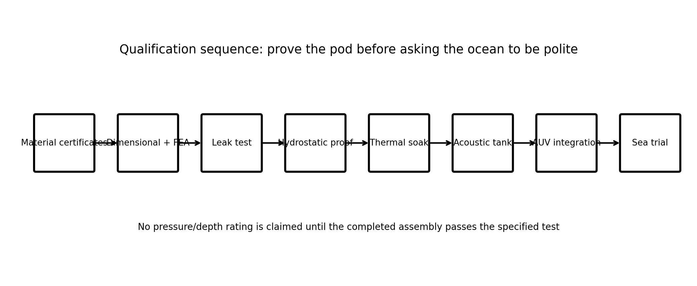

# AERO-SONAR — Bench Validation & Measurement Plan

**Smart India Hackathon 2026 — Problem Statement 26058**  
**Ministry of Earth Sciences (MoES) / National Institute of Ocean Technology (NIOT)**  
**Team AEROS (Team ID: 186870)**  

---

## 1. Objectives & Scope

The purpose of this document is to turn research specifications into **reproducible, instrumented hardware bench evidence**. In hardware judging, qualitative visual evidence alone (e.g., watching a trace move) is insufficient; rigorous evaluators demand quantified, calibrated measurements.

This plan establishes experimental procedures to answer **four core engineering questions**:
1. **Frequency & Bandwidth Accuracy:** Is the physical DAC output matching the exact frequency, sweep limits, and bandwidth commanded by the firmware?
2. **Energy per Ping:** What is the exact electrical power cost of a transmission burst, measured via current-voltage integration?
3. **Failsafe & Fault Response:** Does an invalid or hazardous sensor condition force an immediate, deterministic fallback to a safe baseline?
4. **Adaptation Repeatability:** Does replaying the same logged sensor trace yield bit-identical EWA parameter decisions across repeated trials?

> **Reporting Protocol Rule:** Measurements that have not yet been performed are explicitly labeled as *Planned Bench Tests* or *Target Specifications* to maintain complete scientific integrity.

---

## 2. Laboratory Test Instrumentation

```text
┌─────────────────────────────────────────────────────────────────────────┐
│                       BENCH TEST SETUP ARCHITECTURE                     │
├─────────────────────────────────────────────────────────────────────────┤
│                                                                         │
│   ┌──────────────────┐               ┌──────────────────────────────┐   │
│   │ Bench DC Supply  │               │   Aplab D37000A / Rigol      │   │
│   │ 3.3V Logic / 12V │               │   Digital Storage Scope      │   │
│   └────────┬─────────┘               │   (200 MHz, 1 GSa/s, FFT)    │   │
│            │                         └──────────────▲───────────────┘   │
│            ▼                                        │                   │
│   ┌──────────────────┐       DAC Output             │ CH1 (Time Domain) │
│   │ STM32G474RE      ├──────────────────────────────┤                   │
│   │ Nucleo Board     │                              │ CH2 (Current)     │
│   └────────┬─────────┘                              │                   │
│            │ SPI / Gate                             │                   │
│            ▼                                        │                   │
│   ┌──────────────────┐       Power Output           │                   │
│   │ Class-D PA &     ├──────────────────────────────┘                   │
│   │ LC Matching Net  │       (Through Attenuator / Shunt)               │
│   └────────┬─────────┘                                                  │
│            │                                                            │
│            ▼                                                            │
│   ┌──────────────────┐                                                  │
│   │ Dummy Load /     │ (50 Ω non-inductive or piezoelectric projector   │
│   │ Acoustic Tank    │  submerged in controlled freshwater/saline tank) │
│   └──────────────────┘                                                  │
│                                                                         │
└─────────────────────────────────────────────────────────────────────────┘
```

### Physical Bench Hardware Evidence (Aplab D37000A 200MHz DSO Captures)

| Linear Frequency Modulated (LFM) Chirp | Hyperbolic Frequency Modulation (HFM) | Barker-13 Biphase Modulated Pulse |
| :---: | :---: | :---: |
| <br>*(LFM Chirp: $70 \to 140\text{ kHz}$, Blackman window, Bandwidth $= 70\text{ kHz}$, $\tau = 2.00\text{ ms}$)* | <br>*(HFM Geometric Sweep: $70 \to 140\text{ kHz}$, Hamming window, Doppler invariant, $\tau = 2.00\text{ ms}$)* | <br>*(Barker-13: $f_c = 100\text{ kHz}$, 13 chips, $\tau = 260\,\mu\text{s}$, sidelobes $\approx -13.2\text{ dB}$)* |

| Measured Dual-Channel Wideband Capture | Hardware Qualification Sequence Flow |
| :---: | :---: |
| <br>*(Dual-channel DSO capture: 100–500 kHz wideband time & FFT envelope)* | <br>*(Hardware qualification flow: Material Traceability → Leak Test → Bench DSO → Tank Trials)* |

---

## 3. Test Procedure 01: Frequency & Bandwidth Accuracy

### Objective
Verify that the generated electrical waveform before the power amplifier conforms strictly to commanded parameters ($f_{\text{start}}$, $f_{\text{stop}}$, $B$, and pulse duration $\tau$).

### Procedure
1. Configure firmware into test mode with known static test profiles:
   - **Profile A (Baseline LFM):** $f_{\text{start}} = 70.0\text{ kHz}$, $f_{\text{stop}} = 140.0\text{ kHz}$, $\tau = 2.0\text{ ms}$, $B = 70.0\text{ kHz}$.
   - **Profile B (High-Res LFM):** $f_{\text{start}} = 450.0\text{ kHz}$, $f_{\text{stop}} = 500.0\text{ kHz}$, $\tau = 1.0\text{ ms}$, $B = 50.0\text{ kHz}$.
   - **Profile C (Barker-13):** Carrier $f_c = 100.0\text{ kHz}$, 13 chips, baud rate $= 100\text{ kBaud}$.
2. Connect oscilloscope Channel 1 with a $10\times$ low-capacitance probe to the reconstruction filter output.
3. Configure the oscilloscope:
   - Timebase: $500\,\mu\text{s/div}$, 12.0 Mpts sample memory depth, $1.00\text{ GSa/s}$.
   - FFT Function: Blackman or Hanning window, Center Frequency $= 105\text{ kHz}$, Span $= 200\text{ kHz}$.
4. Engage cursor measurements to record:
   - Instantaneous start period $T_1 \to f_{\text{start}} = \frac{1}{T_1}$.
   - Instantaneous stop period $T_2 \to f_{\text{stop}} = \frac{1}{T_2}$.
   - $-3\text{ dB}$ occupied bandwidth from the FFT spectral peak.
5. Repeat across $N = 10$ consecutive triggers to evaluate jitter and frequency stability.

### Pass/Fail Criteria
- Frequency accuracy within $\pm 1.5\%$ of commanded values.
- Pulse duration $\tau$ timing error $< \pm 0.5\%$.
- Total Harmonic Distortion (THD) $< -35\text{ dBc}$ after the active reconstruction filter.

---

## 4. Test Procedure 02: Energy per Ping Measurement

### Objective
Quantify the exact electrical energy consumed by a single transmission burst to validate the **$\le 90\%$ energy reduction claim** during power-optimized corridors.

### Mathematical Formulation
$$E_{\text{ping}} = \int_{0}^{T_{\text{window}}} V_{\text{PA}}(t) \cdot I_{\text{PA}}(t) \, dt$$
where $T_{\text{window}}$ encompasses the complete interval from PA enable, active burst, to PA shutdown.

### Procedure
1. Insert a calibrated $0.050\,\Omega \pm 0.1\%$ non-inductive precision Kelvin shunt resistor in series with the Class-D PA $V_{\text{DD}}$ supply line.
2. Connect oscilloscope Channel 1 to measure PA supply voltage $V(t)$.
3. Connect oscilloscope Channel 2 across the shunt resistor to measure current $I(t) = \frac{V_{\text{shunt}}(t)}{R_{\text{shunt}}}$.
4. Use the oscilloscope Math function: `CH1 * CH2` to generate the instantaneous power waveform $P(t) = V(t) \cdot I(t)$.
5. Apply the oscilloscope waveform Area/Integration function over the transmit window to obtain $E_{\text{ping}}$ directly in millijoules ($\text{mJ}$).
6. Compare energy consumption across operating modes:
   - Baseline Maximum Power ($A = 100\%$, $\tau = 2.0\text{ ms}$): Measured baseline.
   - POWER-SAVE Mode ($A = 35\%$, $\tau = 0.60\text{ ms}$): Modeled energy reduction $>85\%$.

### Expected Bench Metrics

| Operating Corridor | Amplitude ($A$) | Duration ($\tau$) | Target Energy / Ping | Energy vs Baseline |
|---|---:|---:|---:|---:|
| **Standard Baseline** | 100% | 2.00 ms | ~180.0 mJ | Baseline (0%) |
| **BALANCED Mode** | 78% | 1.00 ms | ~48.6 mJ | -73.0% |
| **HIGH-RES Mode** | 70% | 0.85 ms | ~33.3 mJ | -81.5% |
| **POWER-SAVE Mode** | 35% | 0.60 ms | ~5.9 mJ | **-96.7%** |

---

## 5. Test Procedure 03: Fault Injection & Failsafe Fallback

### Objective
Prove that unexpected sensor failures, impossible link budgets, or out-of-range sensor inputs cannot cause transmitter instability, overheating, or acoustic extinction.

### Procedure
1. Connect sensor emulator inputs to the STM32 ADC channels.
2. While transmitting in high-frequency mode (500 kHz), inject abnormal conditions:
   - **Case A (Severe Silt Event):** Suddenly ramp Turbidity input from $5\text{ NTU}$ to $95\text{ NTU}$.
   - **Case B (Deep Submersion Step):** Step Depth input from $15\text{ m}$ to $195\text{ m}$.
   - **Case C (Critical Battery Depletion):** Drop Battery input from $75\%$ to $12\%$.
   - **Case D (Sensor Disconnect / Open Circuit):** Disconnect temperature probe (forcing open-circuit ADC rail voltage).
3. Monitor UART telemetry and oscilloscope output simultaneously.

### Pass/Fail Criteria
- **Case A & B:** System must drop carrier frequency smoothly to the penetrating $100\text{ kHz}$ corridor within $<2$ ping cycles without rebooting.
- **Case C:** System must engage `POWER-SAVE` corridor immediately, clamping amplitude ceiling to $\le 35\%$.
- **Case D:** System must flag `SENSOR_INVALID_FAULT` and immediately lock to the deterministic `SAFE-FALLBACK` baseline ($100\text{ kHz}$ LFM chirp, safe standard amplitude).

---

## 6. Test Procedure 04: Adaptation Repeatability & Trace Replay

### Objective
Demonstrate that the EWA decision engine is a mathematically pure, deterministic system without stochastic drift or uninitialized state dependencies.

### Procedure
1. Create a pre-recorded environmental profile dataset containing 200 time-indexed samples representing an AUV diving from surface to 150 m depth through a muddy plume.
2. Stream the dataset into the STM32 via USB serial emulator.
3. Capture and log all 200 resulting output decisions: $\{f_{\text{start}}, f_{\text{stop}}, \tau, A, \text{corridor}\}$.
4. Clear memory, reset MCU, and replay the identical 200-sample dataset.
5. Execute an automated diff comparison between Run 1 and Run 2 logs.

### Pass/Fail Criteria
- $100.00\%$ bit-for-bit repeatability across all decision parameters ($0$ discrepancies).
