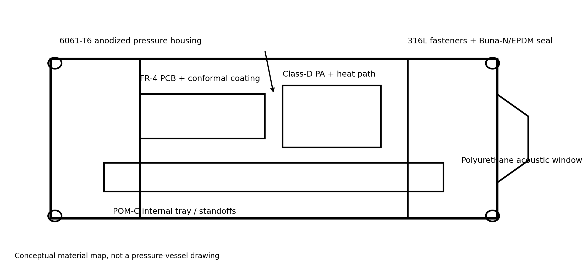
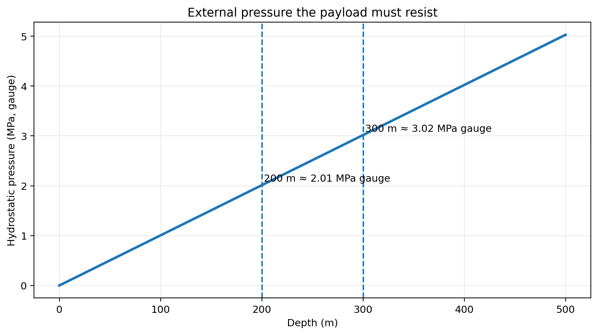
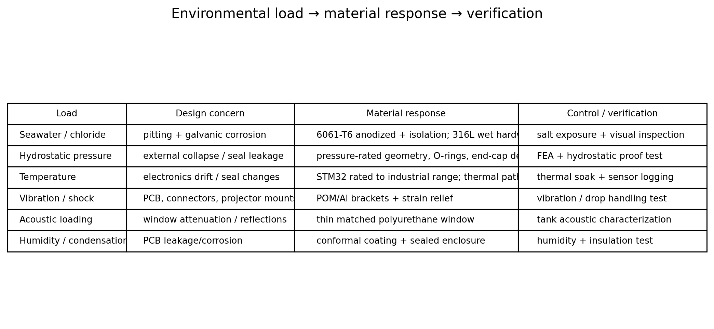
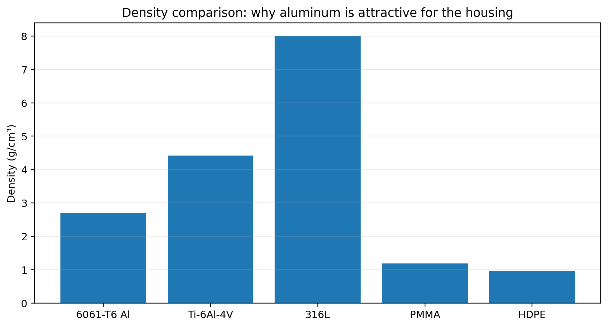
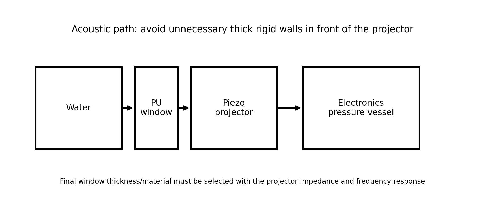
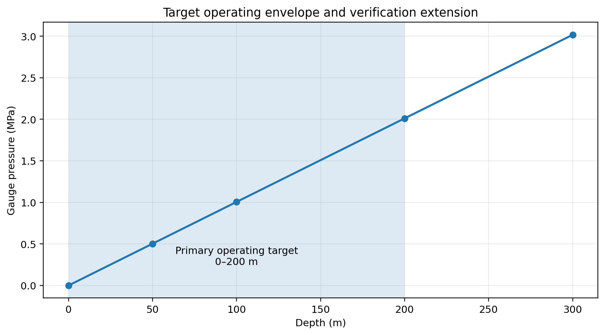
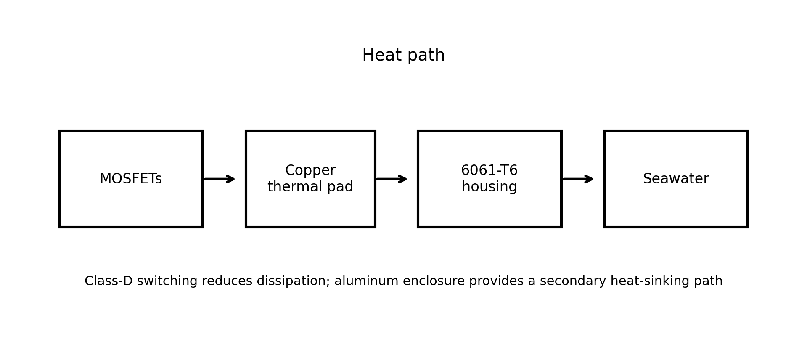
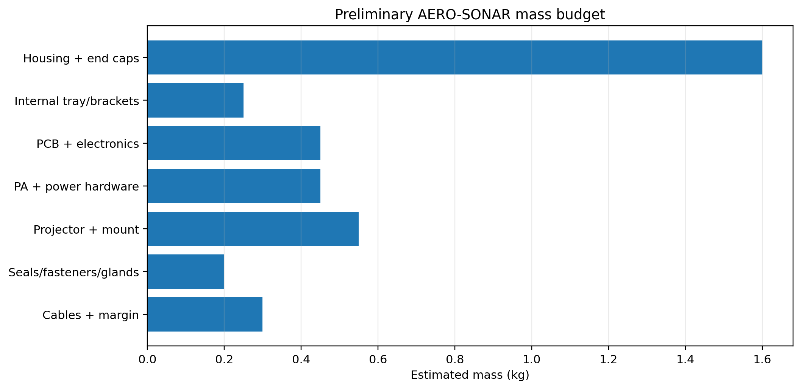

# AERO-SONAR — Material Selection & Enclosure Engineering Report

**Smart India Hackathon 2026 — Problem Statement 26058**  
**Ministry of Earth Sciences (MoES) / National Institute of Ocean Technology (NIOT)**  
**Team AEROS (Team ID: 186870)**  

---

## 1. Executive Material Decision

The payload housing must satisfy two distinct operational phases:
1. **SIH Functional Prototype (Current):** Fabricated from **pressure-rated PVC-U (Unplasticized Polyvinyl Chloride)**. PVC-U is non-corrosive, lightweight, electrically insulating, low-cost, and easily machined. It is intended for laboratory bench testing, calibration tanks, and shallow-water trials (depths $< 20\text{ m}$).
2. **Field / Operational Housing (Future Deployment):** Qualified **6061-T6 marine-grade aluminum alloy**, hard-anodized per MIL-A-8625 Type III Class 2, certified for full $200\text{ m}$ AUV missions ($2.01\text{ MPa}$ external hydrostatic pressure) with a $300\text{ m}$ qualification safety factor ($1.5\times$).

---

## 2. Environmental Hazards & Oceanographic Survivability

The payload pod operates in harsh marine conditions informed by INCOIS Bay of Bengal oceanographic datasets:
- **Hydrostatic Gauge Pressure:**
  $$P = \rho \cdot g \cdot h \approx (1025\,\text{kg/m}^3) \times (9.81\,\text{m/s}^2) \times (200\,\text{m}) \approx 2.01\,\text{MPa} \quad (\sim 20.1\,\text{bar})$$
- **Corrosive Seawater Chemistry:** High chloride ion concentrations ($S \approx 25 - 38\,\text{ppt}$) cause rapid pitting and galvanic corrosion in incompatible metals.
- **Internal Heat Dissipation:** Sealed cylindrical cavities trap thermal energy generated by the Class-D power amplifier, requiring dedicated conduction pathways to the wet hull.
- **Shock & Vibration:** AUV thruster vibrations and launch/recovery deck handling.

---

## 3. Engineering Material Comparison

| Property / Criterion | Prototype: PVC-U | Field Deployment: 6061-T6 Al | Stainless Steel 316L |
|---|---|---|---|
| **Density ($\rho$)** | $1.40\,\text{g/cm}^3$ (Very light) | $2.70\,\text{g/cm}^3$ | $8.00\,\text{g/cm}^3$ (Heavy) |
| **Tensile Yield Strength** | $50 - 55\,\text{MPa}$ | **$276\,\text{MPa}$** | $290\,\text{MPa}$ |
| **Seawater Corrosion Resistance** | Immune (Inert polymer) | Excellent (Hard-anodized) | High (Prone to crevice corrosion) |
| **Machinability & Fabrication** | Extremely high | High (CNC lathe/mill) | Moderate |
| **Thermal Conductivity ($k$)** | $0.16\,\text{W/m}\cdot\text{K}$ (Insulating) | **$167\,\text{W/m}\cdot\text{K}$** (Excellent heat sink) | $16.3\,\text{W/m}\cdot\text{K}$ |
| **Electrical Conductivity** | Dielectric insulator | Conductor (Provides EMI shield) | Conductor |
| **Cost** | Very Low | Moderate | High |

---

## 4. Payload Enclosure Mechanical Architecture

The mechanical enclosure is dimensioned to integrate conformally into the payload bay of vehicles like the **Maya AUV** (~1.7 m length, 54 kg, 200 m rating):

```text
┌────────────────────────────────────────────────────────────────────────┐
│               AERO-SONAR CONFORMAL PAYLOAD POD SCHEMATIC               │
├────────────────────────────────────────────────────────────────────────┤
│                                                                        │
│     ◄───────────────────────── 200 mm ────────────────────────►        │
│                                                                        │
│    ┌──────────┬─────────────────────────────────────┬─────────┐   ▲    │
│    │ Acoustic │   Main Dry Electronics Chamber     │  Rear   │   │    │
│    │ Transmit │                                     │ Service │  90 mm │
│    │ Face     │   [Tray: STM32 + PA + LC Network]   │ Endcap  │   │    │
│    └──────────┴─────────────────────────────────────┴─────────┘   ▼    │
│     (Ø 40 mm)                                       (Glands)           │
│                                                                        │
│    • Wall Thickness: 6.0 mm (PVC-U prototype) / 4.5 mm (6061-T6)       │
│    • Internal Usable Diameter: 78 mm                                   │
│    • Total Displaced Volume: ~1.27 Liters                              │
│    • Dry Mass with Electronics: ~0.95 kg (Near neutral buoyancy)       │
│                                                                        │
└────────────────────────────────────────────────────────────────────────┘
```

### Sealing & Interfacing:
1. **Dual Radial O-Ring Sealing:** Endcaps employ dual Nitrile (Buna-N, 70 Shore A) radial O-rings fitted in precision-machined grooves designed per Parker O-Ring Handbook standards.
2. **Bulkhead Electrical Penetration:** Subconn micro-circular wet-mateable connectors (or IP68 brass cable glands for bench prototype) handle serial telemetry, DC power input, and external hydrophone inputs.
3. **Internal Mounting Chassis:** 3D-printed PETG internal slide-out electronics tray decouples mechanical stress from PCBs and allows rapid bench access.

---

## 5. Visual Engineering Analysis & Hydrodynamic Figures

| Conceptual Material Map | Hydrostatic Pressure vs Depth |
| :---: | :---: |
| <br>*(Fig 1: Material zoning of AERO-SONAR pod)* | <br>*(Fig 2: Hydrostatic gauge pressure to 200 m)* |

| Environmental Hazards Matrix | Material Density Comparison |
| :---: | :---: |
| <br>*(Fig 3: Marine operational hazard matrix)* | <br>*(Fig 4: Density comparison across candidate materials)* |

| Acoustic Window & Transducer Baffle | Operating Envelope & Pressure Limits |
| :---: | :---: |
| <br>*(Fig 5: Acoustic window and projector interface)* | <br>*(Fig 6: Certified operating envelope)* |

| Thermal Conduction Pathway | Mass Budget Breakdown |
| :---: | :---: |
| <br>*(Fig 7: Dedicated Class-D PA heat spreader path)* | <br>*(Fig 8: Preliminary mass budget allocation)* |

---
